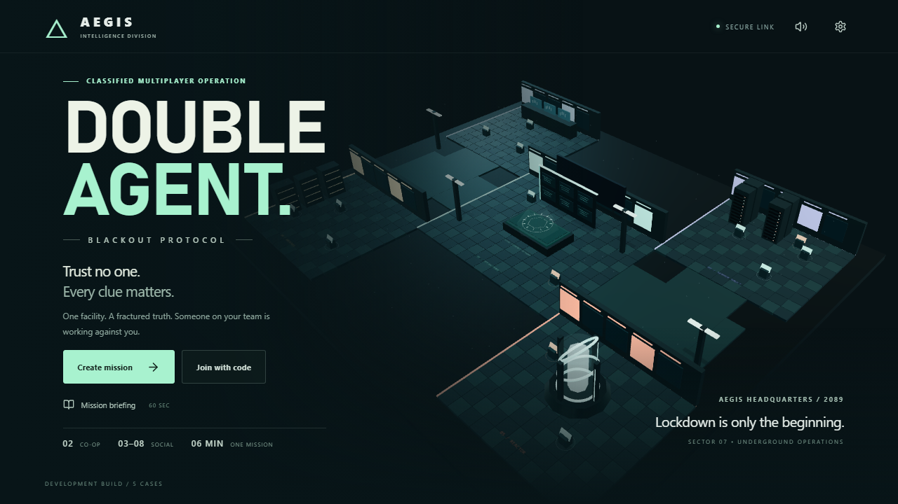

# DOUBLE AGENT: BLACKOUT PROTOCOL

**Trust no one. Every clue matters.**

A 3D multiplayer espionage investigation for the browser. Explore AEGIS headquarters, recover private clues, reconstruct the breach on a shared Evidence Wall, and identify the double agent before an enemy upload succeeds.

**[Play the game](https://double-agent-blackout-protocol-radhe12.vercel.app/) · [Game rules](GAME_RULES.md) · [Testing report](TEST_REPORT.md) · [Deployment guide](docs/DEPLOYMENT.md)**



*Actual screenshot of the deployed game's main menu, captured October 17, 2026. The headquarters behind the interface is rendered in real time.*

## Start playing

No installation, account registration, or email is required.

| Mode | Players | Objective |
| --- | --- | --- |
| Cooperative investigation | 2 | Work together to expose an NPC saboteur. Recommended for a first review. |
| Social deduction | 3–8 | Investigate alongside one hidden human traitor. |

A complete mission takes approximately six minutes.

1. Open the **[public game](https://double-agent-blackout-protocol-radhe12.vercel.app/)** and choose **Create mission**.
2. Select a case and mode. Co-op is selected initially.
3. Share the six-character room code or invitation link. Other players choose **Join with code**.
4. Each player marks ready, then the host starts the mission.
5. Read your private role, follow the investigation prompts, and compare findings with your team.
6. After the result, use the rematch control to play again in the same room.

**Reviewing on one computer?** Use separate browser profiles or different browsers for each player. Tabs in the same profile share a guest identity and cannot act as separate players. Two devices also work.

The menu's **Mission briefing** introduces the essentials. Sound and graphics controls are available in **Settings**.

## How to play

### Investigate the facility

Move through five connected sectors: **Operations Center, Surveillance Room, Server Vault, Classified Archives,** and **Reactor Room**. Find the evidence terminals assigned to you, approach them, and scan their records. Private clue assignments split the investigation across the team.

### Build the Living Evidence Wall

Return to Operations to publish your findings. Authenticate records at a verification terminal, then use their signed facts to support comparisons on the shared wall.

Connections require the correct records, relationship, and supporting value. Arbitrary links are rejected. Every non-abstaining ballot must cite a source published on this wall, making evidence sharing part of the actual decision process.

Look for the suspect present in **both authenticated custody groups**. Discuss inconsistencies before accusing anyone.

### Repair systems and counter sabotage

Three interactive repair activities offer different benefits:

| System | Activity | Benefit |
| --- | --- | --- |
| Surveillance | Match a waveform frequency | Authenticate evidence faster |
| Uplink | Route a symbol circuit | Permanently block enemy exfiltration |
| Reactor | Match a pressure setting | Extend investigation time |

The human traitor can forge a camera timestamp, jam verification, stall a repair, or attempt exfiltration. Actions require proximity, limited charges, and cooldowns. Authentication reveals tampering; an announced upload can be stopped at an emergency console or blocked by repairs.

### Discuss, vote, and replay

Ballots remain private until resolution. A valid indictment requires a unique leading suspect, at least two nominations, and the required participation quorum. In co-op, both players must agree.

- **Correct indictment:** agents win.
- **Wrong indictment or completed enemy upload:** the opposing side wins.
- **Inconclusive vote:** one runoff; two completed repairs can preserve a draw.
- **Lost connection:** reconnect with the same browser identity. Host migration and quorum grace periods prevent immediate disruption.

The full rules for abstentions, ties, recovery, disconnects, scoring, and sabotage are documented in **[GAME_RULES.md](GAME_RULES.md)**.

## Controls

| Action | Desktop | Mobile / touch |
| --- | --- | --- |
| Move | WASD, arrow keys, or click the floor | Touch direction buttons or tap a destination |
| Reach a console | Select it through **Facility**, or walk to it | Select through **Facility**, or tap a destination |
| Investigate / repair | Approach and use the contextual controls | Approach and tap the contextual controls |
| Share and compare evidence | Use the Operations Evidence Wall | Use the same touch-accessible wall controls |
| Communicate | Chat and contextual quick messages | Chat and contextual quick messages |
| Adjust sound and rendering | Settings | Settings |

## Five handcrafted cases

Each case uses signed records, an identifying intersection of suspect groups, and a distinct reconstruction puzzle. No runtime AI invents the solution.

| Case | Investigation |
| --- | --- |
| The Ninety-Second Ghost | Reconcile conflicting surveillance and clock timestamps |
| The Mirror Courier | Decode a reflected badge identifier |
| The Silent Relay | Reconstruct a transmission across time zones |
| Cold Storage | Recover the order of a rolled-back transfer sequence |
| The Midnight Dead Drop | Resolve a timestamp discrepancy across midnight |

Roles, clue assignments, and suspect groups vary between rounds. The cases share the facility and core evidence structure; evidence terminal positions are currently fixed.

## Project status and reviewer notes

This is a **publicly playable development release**, prepared for the Handshake AI Skills Studio Multiplayer Game Challenge.

**Implemented:** real room creation and joining, private roles and clues, synchronized movement, five cases, the shared Evidence Wall, repairs, sabotage, voting, results, reconnects, host migration, cumulative scores, and same-room rematches. The headquarters uses original procedural 3D geometry and synthesized audio.

**Verified:** the recorded [successful CI run](https://github.com/IntelliCoder-AI/double-agent-blackout-protocol-multi-player-game/actions/runs/38936066317) passed 35 automated tests and the production build. Independent browser contexts completed a public co-op round through evidence recovery, authentication, wall comparisons, voting, victory, and rematch with zero JavaScript page errors. Additional browser checks covered private-state protections, rejected invalid actions, reconnects, host migration, and mobile-emulated touch movement.

**Remaining release gates:** physical Android/iPhone testing, human balance and onboarding sessions, broader social-mode and weak-network testing, walkthroughs of every case, and final visual/performance polish. Mobile emulation does not establish real-phone performance. The current social mode uses one traitor; advanced two-traitor play is deferred.

See **[TEST_REPORT.md](TEST_REPORT.md)** for evidence, measured results, and limitations. The hosted build is configured for **five simultaneous rooms**; it is not a large-scale concurrency deployment.

## Technology and security

| Layer | Implementation |
| --- | --- |
| Interface | React 19, TypeScript, Vite |
| 3D rendering | Three.js and React Three Fiber |
| Public hosting | Vercel |
| Hosted multiplayer | Server-authoritative HTTPS commands and filtered snapshots |
| Persistent state | Private Neon PostgreSQL database |
| Alternative local/server transport | Dedicated Node.js server with WebSockets |
| Development database | Embedded PostgreSQL via PGlite |
| Validation | Node test runner, PostgreSQL transaction tests, Playwright, and live-browser scripts |

The hosted game uses HTTPS synchronization rather than a persistent WebSocket server on Vercel. PostgreSQL transactions serialize authoritative changes across function instances. The dedicated Node transport uses WebSockets.

Roles, canonical evidence, sabotage permissions, timers, ballots, and scores are controlled by the server. Clients receive filtered state. Guest sessions use HttpOnly cookies; sensitive commands are validated and rate-limited. Browsers never connect directly to the database.

## Run locally

Requires **Node.js 22.12 or newer** and npm.

```sh
git clone https://github.com/IntelliCoder-AI/double-agent-blackout-protocol-multi-player-game.git
cd double-agent-blackout-protocol-multi-player-game
npm ci
npm run dev
```

Open **http://localhost:3000**.

Development creates an embedded database under `.data/local-postgres`; no separate database installation is needed. The development server binds to loopback. Use the public HTTPS deployment for device testing.

Environment variables can be supplied by your shell. The application does not automatically load `.env`; to load one explicitly:

```sh
node --env-file=.env --import tsx server/index.ts
```

Keep database credentials server-side and out of version control. Never put secrets in variables prefixed with `VITE_`.

## Run checks

```sh
npm test
npm run build
npm run test:network
```

For the local browser suite, keep `npm run dev` running in another terminal:

```sh
npx playwright install chromium
npm run test:browser
```

The browser suite accepts `TEST_URL` for an existing deployment. Separate hosted verification scripts are in `tests/live/`. See the testing report for their configuration and recorded coverage.

Settings can measure and export rendering performance. Results can export anonymized round metrics and optional participant feedback; **[PLAYTEST_GUIDE.md](PLAYTEST_GUIDE.md)** explains the testing workflow.

## Deploy your own instance

The current public deployment uses **Vercel + Neon**. A dedicated **Node.js + PostgreSQL** deployment is also supported.

Follow **[docs/DEPLOYMENT.md](docs/DEPLOYMENT.md)** for environment variables, migrations, health checks, capacity limits, and the different restart behavior of each transport. A static-only host cannot run the authoritative backend.

## Repository guide

| Path | Purpose |
| --- | --- |
| `src/` | React interface, interactive 3D headquarters, graphics, and audio |
| `server/engine.ts` | Authoritative gameplay, private state, phases, and outcomes |
| `server/case.ts` | Handcrafted mysteries, canonical evidence, and forgery variants |
| `server/`, `api/` | Dedicated and hosted server entry points, persistence, and request handling |
| `shared/` | Facility geometry, collision, navigation, and shared types |
| `tests/` | Rules, database, networking, and browser verification |
| `docs/` | Deployment documentation and README screenshot |
| [GAME_RULES.md](GAME_RULES.md) | Exact gameplay and fairness rules |
| [TEST_REPORT.md](TEST_REPORT.md) | Completed checks and outstanding release gates |
| [PLAYTEST_GUIDE.md](PLAYTEST_GUIDE.md) | Device and human playtest instructions |
| [SUBMISSION.md](SUBMISSION.md) | Challenge submission material |
| [THIRD_PARTY_NOTICES.txt](THIRD_PARTY_NOTICES.txt) | Dependency license notices |

Environment geometry and synthesized interface tones are original code. The game does not require downloaded models, external textures, or static images standing in for the 3D world.
